<p align="center">
  <picture>
    <source media="(prefers-color-scheme: dark)" srcset="assets/dark/header-projects.svg">
    
  </picture>
</p>

<p align="center">
  <a href="README.md"></a>&nbsp;
  <a href="STACK.md"></a>&nbsp;
  <a href="WHOAMI.md"></a>
</p>

```console
$ ls -l ~/projects
drwxr-xr-x  0x00f6  ebpf-network-nexus/   TLS · HTTPS · HTTP/3, keys straight from RAM
drwxr-xr-x  0x00f6  clickhouse/           MaxMindDB table engine · PR #126009 (1/3)
drwxr-xr-x  0x00f6  pinned/               4 more repos, listed at the bottom
```

<picture>
  <source media="(prefers-color-scheme: dark)" srcset="assets/dark/divider.svg">
  
</picture>

## 0x01 — eBPF Network Nexus

<p align="center">
  <picture>
    <source media="(prefers-color-scheme: dark)" srcset="assets/dark/card-nexus.svg">
    
  </picture>
</p>

<p align="center">
  
  
  
  
  
  
  
</p>

### `▸ problem`

Almost everything on the wire is encrypted now: TLS 1.3, HTTPS, HTTP/3 over QUIC. Great for privacy, painful when you need to see what **your own** processes are actually saying. Proxies have to sit in the middle and change the traffic; key-log files only work when the application cooperates.

### `▸ approach`

1. **Observe** — eBPF programs capture TLS records and QUIC datagrams in the kernel and tie each flow to the process that sent it.
2. **Hunt** — the agent scans that process's memory for candidate AES (and other) session keys.
3. **Decrypt** — candidates are tested against the captured records; the one that decrypts them unlocks the flow.
4. **Decompress & parse** — bodies are inflated, then HTTP/1.1, HTTP/2 and HTTP/3 are rebuilt into readable exchanges.
5. **Inspect** — everything streams to a web **Packet Inspector** with a *perspective* table, served on `localhost:8080`.

<p align="center">
  <picture>
    <source media="(prefers-color-scheme: dark)" srcset="assets/dark/nexus-pipeline.svg">
    
  </picture>
</p>

> [!WARNING]
> Nexus reads other processes' memory and decrypts their traffic. Run it only on machines you own or are explicitly authorized to analyze.

### `▸ tech`

| layer | stack |
| --- | --- |
| kernel | eBPF programs on Linux |
| agent | Rust, userspace |
| crypto | TLS record layer · QUIC packet protection · AES session keys |
| protocols | HTTP/1.1 · HTTP/2 · HTTP/3 |
| ui | web Packet Inspector · `localhost:8080` |

### `▸ links`

- **source** — not public yet, coming soon <!-- ✏️ add the repository URL here once it is public -->
- **related** — [eBPF-ip-reputation-firewall](https://github.com/0x00F6/eBPF-ip-reputation-firewall): the same kernel-side toolbox (Rust + Aya + XDP), pointed at dropping bad IPs instead of reading good ones

<picture>
  <source media="(prefers-color-scheme: dark)" srcset="assets/dark/divider.svg">
  
</picture>

## 0x02 — ClickHouse × MaxMindDB

<p align="center">
  <picture>
    <source media="(prefers-color-scheme: dark)" srcset="assets/dark/card-clickhouse.svg">
    
  </picture>
</p>

<p align="center">
  
  
  
  
  
  
  
  <a href="https://github.com/ClickHouse/ClickHouse/pull/126009"></a>
</p>

### `▸ problem`

Enriching access logs with GeoIP data in ClickHouse usually means importing MaxMind data first, then keeping that copy in sync with every database release. But the `.mmdb` file is already a compact binary search tree built for exactly these lookups, so why not query it in place?

### `▸ approach`

An experimental, read-only `MaxMindDB` table engine that answers lookups straight from the file:

- **opt-in** — gated by `allow_experimental_maxminddb_table_engine`; built on a bundled `libmaxminddb` 1.14.1, wired in as an optional CMake dependency.
- **local & safe** — `.mmdb` files are read only from the server's `user_files_path`, with `READ ON FILE` enforced.
- **fast path** — IPv4 and IPv6 longest-prefix lookups driven by bounded `WHERE ip = …` / `WHERE ip IN (…)` predicates.
- **typed** — manual schemas or automatic inference, nested tuples / arrays / maps, and only the requested fields get decoded.
- **hot swaps** — replacement files are validated against the persisted schema, and running readers keep their own immutable generation.

```sql
SET allow_experimental_maxminddb_table_engine = 1;

CREATE TABLE geoip ENGINE = MaxMindDB('GeoLite2-City.mmdb')
SETTINGS refresh_interval = '5m';

SELECT country.iso_code FROM geoip WHERE ip = toIPv4('8.8.8.8');
```

<details>
<summary><samp>$ git log --oneline --graph maxminddb</samp> · how the work is split</summary>
<br>

The original [#123672](https://github.com/ClickHouse/ClickHouse/pull/123672) was split into three reviewable, stacked changes, as asked during review.

| step | scope | where |
| --- | --- | --- |
| **1/3 core** | local engine, schema inference, IPv4/IPv6 lookups, functional tests, docs | [ClickHouse#126009](https://github.com/ClickHouse/ClickHouse/pull/126009) |
| **2/3 advanced** | direct `JOIN`, snapshots, bounded decoding caches | [0x00F6/ClickHouse#1](https://github.com/0x00F6/ClickHouse/pull/1) |
| **3/3 remote** | HTTP / S3 sources, authentication, security, hot reload | [0x00F6/ClickHouse#2](https://github.com/0x00F6/ClickHouse/pull/2) |

Steps 2 and 3 live on the fork until their base branches exist upstream.

</details>

### `▸ tech`

| layer | stack |
| --- | --- |
| engine | C++ inside the ClickHouse server |
| reader | `libmaxminddb` (C), bundled |
| build | CMake, optional dependency |
| query | SQL · IPv4 / IPv6 types |
| data | MaxMind DB (`.mmdb`) |

### `▸ links`

- **pull request** — [ClickHouse/ClickHouse#126009](https://github.com/ClickHouse/ClickHouse/pull/126009) (part 1 of 3, live state in the badge above)
- **origin** — [ClickHouse/ClickHouse#123672](https://github.com/ClickHouse/ClickHouse/pull/123672)
- **related** — [libmaxminddb-rs](https://github.com/0x00F6/libmaxminddb-rs): a pure Rust MMDB v2 reader *and* writer with zero-copy decoding · [docs](https://0x00f6.github.io/libmaxminddb-rs)

<picture>
  <source media="(prefers-color-scheme: dark)" srcset="assets/dark/divider.svg">
  
</picture>

## `$ ls ~/projects/pinned`

| repo | what it does | lang |
| --- | --- | --- |
| [libmaxminddb-rs](https://github.com/0x00F6/libmaxminddb-rs) | Pure Rust MaxMind DB v2 (IPv4/IPv6) reader and writer, zero-copy borrowed decoding · [docs](https://0x00f6.github.io/libmaxminddb-rs) |  |
| [eBPF-ip-reputation-firewall](https://github.com/0x00F6/eBPF-ip-reputation-firewall) | Ultra-low-latency ingress firewall in Rust with Aya, filtering at the NIC driver level with XDP |  |
| [haproxy-spoa-ip-reputation-firehol](https://github.com/0x00F6/haproxy-spoa-ip-reputation-firehol) | HAProxy external agent (SPOA) that blocks malicious IPs in real time from FireHOL blocklists |  |
| [blink-sentinel](https://github.com/0x00F6/blink-sentinel) | Arms and disarms a Blink system from your phone's Wi-Fi or Bluetooth presence |  |

<p align="center">
  <a href="README.md"></a>&nbsp;
  <a href="STACK.md"></a>&nbsp;
  <a href="WHOAMI.md"></a>
</p>
