<!-- 0x00F6 · profile README · terminal / cyberpunk / rust -->
<!-- dark & light variants are switched with <picture> + prefers-color-scheme; every asset lives in ./assets -->

<p align="center">
  <picture>
    <source media="(prefers-color-scheme: dark)" srcset="assets/dark/banner.svg">
    
  </picture>
</p>

<p align="center">
  <picture>
    <source media="(prefers-color-scheme: dark)" srcset="https://readme-typing-svg.demolab.com?font=JetBrains+Mono&size=18&duration=2800&pause=1000&color=00F0FF&center=true&vCenter=true&width=640&height=34&lines=Hooking+the+kernel+with+eBPF+%2B+Rust+%28Aya%29;Decrypting+my+own+TLS+1.3+%2F+HTTP%2F3+traffic+%E2%80%94+live;Teaching+ClickHouse+to+read+MaxMind+DBs+%28PR+%23126009%29;Zero-copy+MMDB+decoding+in+pure+Rust;Dropping+bad+IPs+at+the+driver+with+XDP">
    
  </picture>
</p>

<p align="center">
  <a href="PROJECTS.md"></a>&nbsp;
  <a href="STACK.md"></a>&nbsp;
  <a href="WHOAMI.md"></a>
</p>

<picture>
  <source media="(prefers-color-scheme: dark)" srcset="assets/dark/divider.svg">
  
</picture>

### `~ $ whoami`

```console
$ whoami
0x00f6                      # U+00F6 → ö · 0xF6 = 246
$ cat ~/.plan
Rust-first systems & network hacker, based in Paris.
Kernel probes with eBPF, packets on the wire, keys in RAM, rows in ClickHouse.
Building things that probably didn't need to be this fast.
```

<picture>
  <source media="(prefers-color-scheme: dark)" srcset="assets/dark/divider.svg">
  
</picture>

### `~ $ cargo tree --depth 1`

<p align="center">
  <picture>
    <source media="(prefers-color-scheme: dark)" srcset="https://skillicons.dev/icons?i=rust,cpp,c,kotlin,linux,bash,git,github,cmake&theme=dark">
    
  </picture>
</p>

<p align="center">
  
  
  
  
  
  
  
</p>

<p align="center"><sub>full manifest → <a href="STACK.md"><code>STACK.md</code></a></sub></p>

<picture>
  <source media="(prefers-color-scheme: dark)" srcset="assets/dark/divider.svg">
  
</picture>

### `~ $ ls ~/projects --featured`

<p align="center">
  <a href="PROJECTS.md#0x01--ebpf-network-nexus"><picture>
    <source media="(prefers-color-scheme: dark)" srcset="assets/dark/card-nexus.svg">
    
  </picture></a>
  <a href="PROJECTS.md#0x02--clickhouse--maxminddb"><picture>
    <source media="(prefers-color-scheme: dark)" srcset="assets/dark/card-clickhouse.svg">
    
  </picture></a>
</p>

- **[eBPF Network Nexus](PROJECTS.md#0x01--ebpf-network-nexus)** — watches TLS, HTTPS and HTTP/3 traffic from the kernel, finds the session keys in the sending process's memory, then decrypts, decompresses and shows every flow in cleartext in a web Packet Inspector. 
- **[ClickHouse × MaxMindDB](PROJECTS.md#0x02--clickhouse--maxminddb)** — an experimental `MaxMindDB` table engine: query a local `.mmdb` file with IPv4/IPv6 longest-prefix lookups, no import step. [](https://github.com/ClickHouse/ClickHouse/pull/126009)

<p align="center"><sub>all sheets + pinned repos → <a href="PROJECTS.md"><code>PROJECTS.md</code></a></sub></p>

<picture>
  <source media="(prefers-color-scheme: dark)" srcset="assets/dark/divider.svg">
  
</picture>

### `~ $ git log --stat`

<p align="center">
  <picture>
    <source media="(prefers-color-scheme: dark)" srcset="https://github-readme-stats.vercel.app/api?username=0x00F6&show_icons=true&include_all_commits=true&hide_border=true&bg_color=00000000&title_color=00F0FF&text_color=C9D1D9&icon_color=FF2BD6&ring_color=FF6B2B&custom_title=%24%20git%20log%20--stat">
    
  </picture>
  <picture>
    <source media="(prefers-color-scheme: dark)" srcset="https://github-readme-stats.vercel.app/api/top-langs/?username=0x00F6&layout=compact&langs_count=6&hide_border=true&bg_color=00000000&title_color=00F0FF&text_color=C9D1D9&custom_title=%24%20tokei">
    
  </picture>
</p>

<details>
<summary><samp>$ cargo run --bin ferris</samp></summary>

```text
   (\/)                (\/)
    \ \    .------.    / /
     \ \  /  o  o  \  / /
      '-.(    __    ).-'
          '-.____.-'
          //  ||  \\        compiled with --release,
                            obviously.
```

</details>

<picture>
  <source media="(prefers-color-scheme: dark)" srcset="https://capsule-render.vercel.app/api?type=waving&section=footer&height=110&color=0:00F0FF,50:FF2BD6,100:FF6B2B">
  
</picture>

<p align="center"><samp>[process exited with code 0] · <a href="PROJECTS.md">projects</a> · <a href="STACK.md">stack</a> · <a href="WHOAMI.md">whoami</a></samp></p>
