<p align="center">
  <picture>
    <source media="(prefers-color-scheme: dark)" srcset="assets/dark/header-stack.svg">
    
  </picture>
</p>

<p align="center">
  <a href="README.md"></a>&nbsp;
  <a href="PROJECTS.md"></a>&nbsp;
  <a href="WHOAMI.md"></a>
</p>

<p align="center">
  <picture>
    <source media="(prefers-color-scheme: dark)" srcset="assets/dark/neofetch.svg">
    
  </picture>
</p>

```toml
# ~/Cargo.toml: what 0x00F6 is built from
[package]
name    = "0x00f6"
version = "0.0.246"             # 0xF6
edition = "2024"

[dependencies]
rust       = { version = "stable", features = ["aya", "zero-copy", "release-profile"] }
ebpf       = { features = ["xdp", "kernel-capture", "maps"] }
networking = { features = ["tls13", "quic", "http3", "http2", "haproxy-spoa"] }
clickhouse = { features = ["table-engines", "cpp"] }
maxminddb  = { features = ["mmdb-v2", "ipv4", "ipv6"] }

[target.'cfg(target_os = "linux")'.dependencies]
linux = "*"

[profile.release]
opt-level = 3                   # it probably didn't need to be this fast
```

<picture>
  <source media="(prefers-color-scheme: dark)" srcset="assets/dark/divider.svg">
  
</picture>

## `[languages]`

| | where it runs |
| --- | --- |
|  | **first choice.** eBPF tooling with Aya, network agents, MMDB parsing, everything new |
|  | ClickHouse internals: the `MaxMindDB` table engine |
|  | `libmaxminddb`, bundled and wired into ClickHouse |
|  | ClickHouse queries and functional tests |
|  | Android: [blink-sentinel](https://github.com/0x00F6/blink-sentinel) |

## `[kernel]`

<p>
  
  
  
  
</p>

- **eBPF** — XDP programs at the driver level, kernel-side traffic capture, maps to hand data to userspace
- **Aya** — eBPF written in Rust on both sides of the boundary
- **Linux** — sockets, the network stack, and process memory when keys are hiding there

## `[network]`

<p>
  
  
  
  
  
</p>

- **crypto & transport** — TLS 1.2 / 1.3 record layer, QUIC
- **application** — HTTP/1.1, HTTP/2, HTTP/3
- **edge** — HAProxy SPOA agents, FireHOL IP reputation lists
- **IP intelligence** — MaxMind DB v2, IPv4/IPv6 longest-prefix lookups

## `[data]`

<p>
  
  
</p>

- **ClickHouse** — table engines, IPv4/IPv6 types, functional tests ([PR #126009](https://github.com/ClickHouse/ClickHouse/pull/126009))
- **MaxMind DB** — the `.mmdb` format from the inside: reading *and* writing it ([libmaxminddb-rs](https://github.com/0x00F6/libmaxminddb-rs))

## `[tooling]`

<p align="center">
  <picture>
    <source media="(prefers-color-scheme: dark)" srcset="https://skillicons.dev/icons?i=rust,cpp,c,kotlin,linux,bash,git,github,cmake&theme=dark">
    
  </picture>
</p>

- **build** — cargo, CMake
- **ship** — git, GitHub, GitHub Pages for docs ([libmaxminddb-rs](https://0x00f6.github.io/libmaxminddb-rs))
<!-- ✏️ editor · terminal · shell · distro — add your daily drivers here, e.g. "- **desk** — neovim · alacritty · zsh · Arch" -->

<p align="center">
  <a href="README.md"></a>&nbsp;
  <a href="PROJECTS.md"></a>&nbsp;
  <a href="WHOAMI.md"></a>
</p>
