<p align="center">
  <picture>
    <source media="(prefers-color-scheme: dark)" srcset="assets/dark/header-whoami.svg">
    
  </picture>
</p>

<p align="center">
  <a href="README.md"></a>&nbsp;
  <a href="PROJECTS.md"></a>&nbsp;
  <a href="STACK.md"></a>
</p>

<p align="center">
  <picture>
    <source media="(prefers-color-scheme: dark)" srcset="assets/dark/whoami-card.svg">
    
  </picture>
</p>

```console
$ whoami
0x00f6
$ printf 'ö\n'
ö
$ printf '%d\n' 0xF6
246
```

<picture>
  <source media="(prefers-color-scheme: dark)" srcset="assets/dark/divider.svg">
  
</picture>

## `> background`

Paris-based systems and network developer. Mostly Rust, some C++ when a database needs a new engine, and as close to the kernel or the wire as the problem allows.

<!-- ✏️ background: studies, jobs, years in the field, what pulled you toward low-level work.
     Two or three short lines keep the terminal feel, e.g.
     "Started with ..., spent N years on ..., now ..." -->

## `> interests`

- **kernel observability** — eBPF programs that see traffic without touching the application
- **network protocols** — TLS 1.3, QUIC, HTTP/3, and what is inside them
- **IP intelligence** — MaxMind DB internals, longest-prefix matching, IP reputation lists
- **databases** — ClickHouse table engines and columnar speed
- **performance** — zero-copy decoding, XDP fast paths, `--release` by default

<!-- ✏️ add non-tech interests here (music, CTFs, hardware, climbing, ...) -->

## `> ~/.plan`

```text
[x] drop bad IPs at the NIC driver with XDP            → eBPF-ip-reputation-firewall
[x] read & write MMDB files in pure Rust               → libmaxminddb-rs
[~] decrypt my own TLS / QUIC traffic from the kernel  → eBPF Network Nexus
[~] teach ClickHouse to query .mmdb files              → PR #126009 (1/3)
[ ] whatever needs to be faster next
```

## `> fun facts`

- `0x00F6` is the code point of **ö** (U+00F6). As a byte it is 246, which is why every version number on this profile ends in `.246`.
- The pixel crab on these pages is a tribute to Ferris, Rust's unofficial mascot.

## `> contact`

| channel | where |
| --- | --- |
| GitHub | [@0x00F6](https://github.com/0x00F6) |
| code talk | issues and pull requests on any of my public repos |
| based in | Paris, FR |

<!-- ✏️ add more channels as table rows above, for example:
| email    | you@example.com |
| Mastodon | @you@instance.social |
| LinkedIn | linkedin.com/in/you |
| PGP      | ABCD 1234 EF56 7890 ... |
-->

<p align="center">
  <a href="README.md"></a>&nbsp;
  <a href="PROJECTS.md"></a>&nbsp;
  <a href="STACK.md"></a>
</p>
